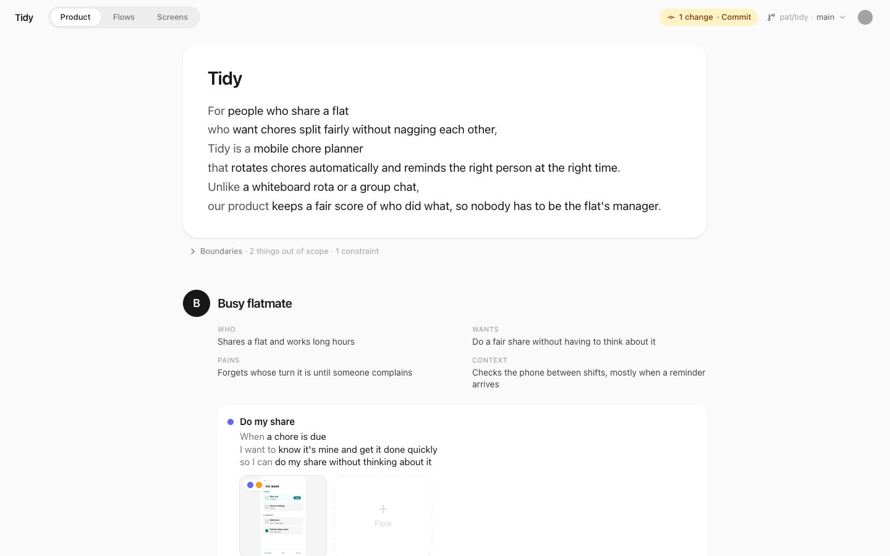
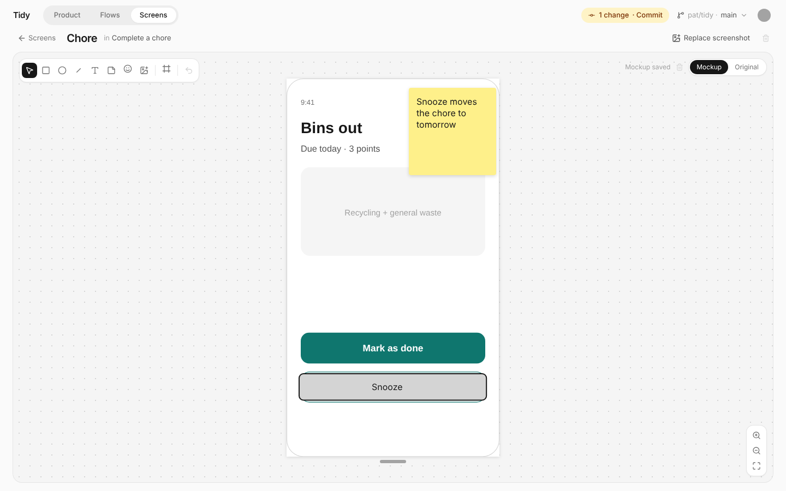

# Aligner

A simple, visual editor for the **product context** your AI coding agent builds from.

The product context is a few plain files in your product's repo, in `product/`:

```
Vision  →  Personas  →  Jobs to be done  →  Flows (steps, with screens and mockups)
```

- **Vision**, with what's out of scope and the constraints;
- **Personas**: who they are, what they want, their pains and their context, and the **jobs** they hire the product for;
- **Flows**, each linked to the jobs it serves, sketched as flowcharts;
- **Screens**, with a screenshot of each and, when it should change, a **mockup**: your changes drawn on the screenshot, or a new screen drawn on a blank phone or laptop or over a sketch your agent made, in the product's own colours, fonts and icons. They sit on a **map** of where each button, link and tab leads: a click zone on it, and an arrow to the screen it opens.

You edit it in **Aligner**, with no IDs and no forms: names, shapes and pictures. Aligner is a web app you run for yourself on Railway and open from any computer or your phone: sign in with GitHub, pick a repository and a branch, and edit; your edits are kept until you commit them, as one commit. Your coding agent reads the product context before every change, builds flows end to end from the flowcharts and mockups, and updates the files to match what it built; your open Aligner page shows its changes when it pushes.





## Your own Aligner, in ten minutes

1. **Fork** this repository on GitHub.
2. In **Railway**, choose **New Project**, **Deploy from GitHub repo**, and pick your fork; then **Settings**, **Networking**, **Generate Domain**, and add a **Volume** mounted at `/data` for your drafts.
3. **Open** that address: Aligner has GitHub create its app, and gives you three lines to paste into Railway's **Variables**.
4. **Sign in with GitHub**, choose your products' repositories, and open one.

When a new version is out, your Aligner shows **Update**, with what it brings: one click updates your fork, and Railway deploys it. What each version brings: [`CHANGELOG.md`](CHANGELOG.md).

The step-by-step guide: [`docs/install.md`](docs/install.md).

- **The format and the agent's rules:** [`product/INSTRUCTIONS.md`](product/INSTRUCTIONS.md)
- **Aligner's own product context** (dogfooding): `product/` · **Example product:** `examples/tidy/`
- **How it's built:** [`docs/architecture.md`](docs/architecture.md)

## Contributing

Issues and pull requests are welcome: see [`CONTRIBUTING.md`](CONTRIBUTING.md) and our [code of conduct](CODE_OF_CONDUCT.md). To report a security issue, see [`SECURITY.md`](SECURITY.md).

## License

- **Code:** the [MIT License](LICENSE).
- **Documentation:** [CC BY 4.0](LICENSE-docs): `README.md`, `CHANGELOG.md`, `docs/` and `product/` (Aligner's own product context).
- **The files Aligner adds to your product** (`product/INSTRUCTIONS.md` and the instruction block in `CLAUDE.md` and `AGENTS.md`) are yours to use and change, with no attribution needed.

[productalignment.org](https://productalignment.org) · hello@productalignment.org
