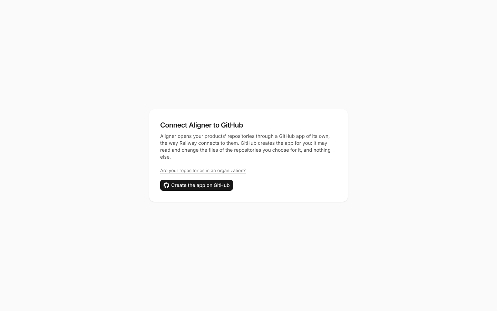
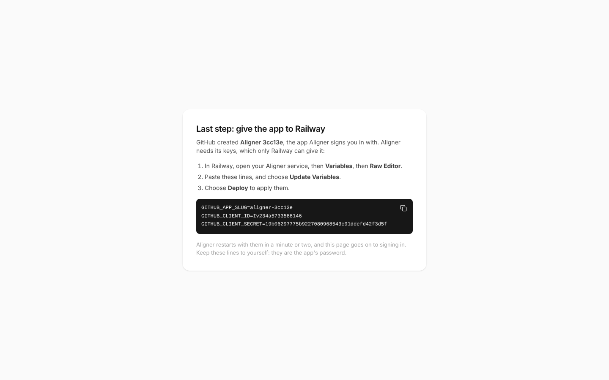

# Your own Aligner, on Railway

Aligner is a web app you run for yourself: your copy of it, on [Railway](https://railway.com), opens your products' repositories on GitHub. You set it up once, in about ten minutes, and then open it from any computer or your phone.

You need a **GitHub account**, with your product's code in a repository there, and a **Railway account** (sign in to Railway with GitHub). A small service like Aligner fits Railway's Hobby plan.

## 1. Copy Aligner
On GitHub, open [productalignment/aligner](https://github.com/productalignment/aligner) and choose **Fork**, then **Create fork**. The copy is yours: Railway runs it, and it changes only when you update it.

## 2. Deploy your copy on Railway
1. In Railway, choose **New Project**, then **Deploy from GitHub repo**, and pick your copy (`your-name/aligner`). If it isn't listed, choose **Configure GitHub App** and give Railway access to it.
2. Railway builds Aligner, which takes a few minutes.
3. Open the service's **Settings**, find **Networking**, and choose **Generate Domain**. That is your Aligner's address, like `aligner-production-1a2b.up.railway.app`. Bookmark it.
4. Give Aligner a **volume**, where it keeps your edits until you commit them: right-click an empty spot of the project canvas (or press ⌘K), choose to add a **Volume**, pick your Aligner service, and set the mount path to `/data`. Railway restarts Aligner with it.

## 3. Connect it to GitHub
1. Open your Aligner's address and choose **Create the app on GitHub**. GitHub shows the app Aligner asks for: it may read and change the files of the repositories you choose for it, and nothing else. Choose **Create GitHub App**. If your products' repositories belong to an organization, choose **Are your repositories in an organization?** first and give its name: the app is then created there, which needs you to be one of its owners.
2. Back in Aligner, copy the three lines it shows. In Railway, open your service's **Variables**, choose **Raw Editor**, paste them, choose **Update Variables**, then **Deploy**. Keep the lines to yourself: they are the app's password.
3. A minute or two later, the Aligner page asks you to **Sign in with GitHub**. Sign in, then choose **Choose repositories** and pick your products' repositories, the way you gave Railway access to yours. Pick your copy of Aligner too, so that it can update itself.

## 4. Use it
- **Open a product.** Pick its repository: it opens on its default branch. The branch menu at the top switches to another branch, or another repository.
- **Start a product.** In a repository with no product context yet, choose **Add product context**. Aligner adds the `product/` folder with `product/INSTRUCTIONS.md`, and an instruction block in `CLAUDE.md` and `AGENTS.md` (appended if those files exist), in one commit. It never overwrites a file.
- **Write it, top to bottom.** On the **Product** page: the vision; a persona (who, wants, pains, context) and the jobs they hire the product for. Under each job, **+ Flow** starts a flow that serves it.
- **Sketch flows.** In **Flows**: pick a shape, click the canvas to place it, and type in it. Drag a step to move it, and drag from a dot on its side to another step to connect them. Click a step to give it a screen.
- **Draw mockups.** In **Screens**: add the screen's screenshot, start on a blank phone or laptop frame, or ask your agent to sketch a new screen, and draw on it, in your product's colours and fonts. It saves as `product/screens/SC-nnn.mockup.png`, which your agent reads.
- **Commit when you're ready.** Each edit is saved at once in your draft of the branch, on any device: the top bar counts your changes. When they're ready, choose **Commit**, say what changed if you like, and they go to the branch as one commit, as you. **Discard** lets them go.
- **Build with your coding agent.** Commit your edits, then ask it (Claude Code on your computer or on the web, or any other agent working on the repository) to build a flow. It pulls your edits, builds the flow end to end, updates the product context to match, and checks it. Once it has pushed, your open Aligner page shows its changes by itself. If it pushes while you have changes not yet committed, Aligner merges them, and tells you about anything you both changed.
- **On your phone.** Open your Aligner's address, sign in, and add it to your home screen.

Your Aligner is on the internet, but it shows nothing to anyone who isn't signed in, and each person sees only the repositories they gave it and can push to. Your product context lives in your repositories; Aligner keeps only your changes not yet committed, on its volume. To keep it that way:
- **Turn on two-factor sign-in** for your GitHub account (**Settings**, **Password and authentication**), and for Railway if you sign in to it other than with GitHub: whoever gets into them gets into your repositories and your Aligner.
- **Lost a phone or a computer?** Open your Aligner on another one and sign out: that signs you out on every device, the lost one too. Then sign in again.

## Updating Aligner
When a new version is out, your Aligner shows **Update** at the top, with what it brings. Choose **Update now**: GitHub brings your copy up to date, Railway deploys it in a few minutes, and the page reloads by itself. If Aligner can't do it for you (say, you changed your copy), open your copy on GitHub and choose **Sync fork**, then **Update branch**.

## If something goes wrong
- **GitHub says the redirect URI isn't associated with the app** when you sign in: you opened Aligner at another address than the one you set it up with. Use that one, or add the new address followed by `/auth/callback` to the app's **Callback URL** (on GitHub: **Settings**, **Developer settings**, **GitHub Apps**, your app).
- **A repository is missing.** Choose **Choose other repositories** and add it. Aligner lists only the repositories you can push to.
- **A commit is refused**: the branch may accept changes only through pull requests. Your changes stay in your draft; commit on a branch that takes them.
- **Aligner forgets your changes when it restarts**: it has no volume yet (step 2). Commit before you update it, then add one.
- **Update now says Aligner can't reach your copy**: add your copy of Aligner to the repositories Aligner opens (**Choose other repositories**), or use **Sync fork** on GitHub.
- **Starting over.** Delete the three variables in Railway and deploy: Aligner asks to connect to GitHub again. Delete the old app on GitHub, under **Settings**, **Developer settings**, **GitHub Apps**.

## Working on Aligner
To change Aligner itself: clone it, run `npm install`, then `npm run dev`, which runs it against a stand-in for GitHub with the example product and prints a link that signs you in. `CLAUDE.md` describes the code and the checks to run before pushing.
